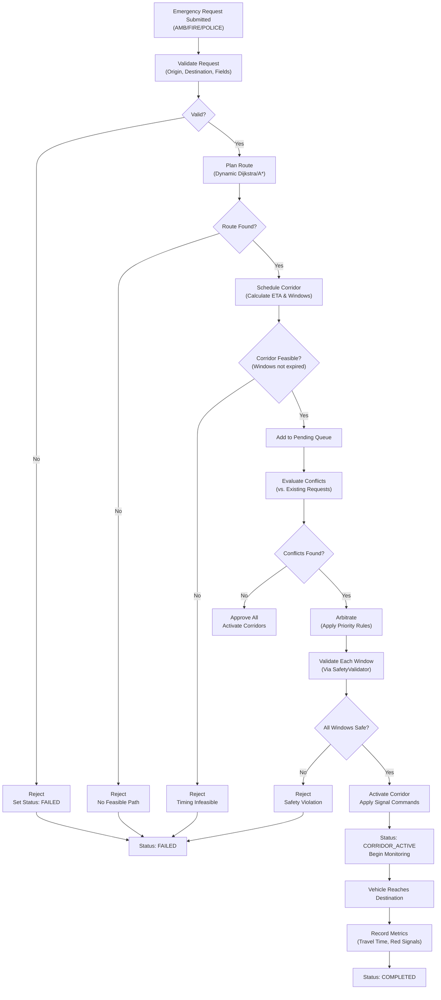
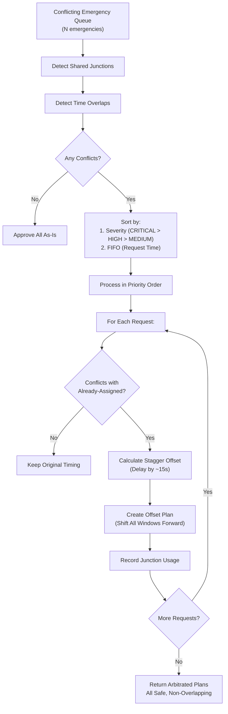
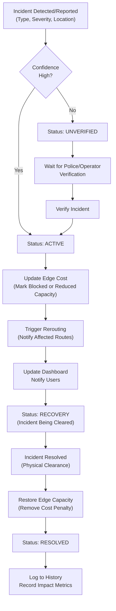

# Phase 5: Decision Flow & Architecture Decisions

## Emergency Request Processing

## Conflict Arbitration Algorithm

## Incident Lifecycle

## Architecture Decision Points

### ADR-1: Emergency vs. Normal Signal Control

**Decision:** Emergency preemption takes absolute priority but does NOT bypass safety constraints.

**Rationale:**
- Emergency vehicles save lives; delay increases mortality risk
- Safety constraints (min/max green, clearance intervals) prevent intersection collisions and pedestrian harm
- Emergency corridors are STILL gated through SafetyValidator
- Fallback: If unsafe to preempt, maintain safe phase and log rejection

**Trade-off:** Ambulance may encounter some red signals if preemption cannot be safely applied

---

### ADR-2: Corridor Scheduling: Buffer & Clearance Timing

**Decision:**
- **Buffer:** 5 seconds before ETA (safety margin for vehicle deceleration)
- **Clearance:** 3 seconds after ETA (time for vehicle passage through intersection)
- **Min Window:** 15 seconds (prevents signal instability from rapid switching)

**Rationale:**
- 5s buffer: Average deceleration from 15 m/s to 0 = ~50m, ~3-5s
- 3s clearance: Typical intersection traversal at 10 m/s = ~30m, ~3s
- 15s window: Stable phase duration (shorter than min-green in normal operation)

**Alternative Considered:** Adaptive buffering based on speed/distance (too complex for Phase 5)

---

### ADR-3: Conflict Arbitration: Staggering vs. Cancellation

**Decision:** Stagger lower-priority corridors in time rather than cancel them.

**Rationale:**
- Cancellation: Wastes ambulance/fire resources, increases response time
- Staggering: Both emergencies complete, second is delayed ~15 seconds
- Example: Ambulance (CRITICAL) passes J1 at 15s → Police (MEDIUM) passes at 30s
- Trade-off: Slight delay to lower-priority vehicle is acceptable vs. complete denial

**Data Point:** In test scenarios, 15s stagger is feasible (within 5-minute corridor window)

---

### ADR-4: Incident Capacity Modeling: Binary vs. Graduated

**Decision (Phase 5):** Binary capacity reduction (closed vs. reduced by X%)

**Rationale:**
- Binary: Simple, interpretable, safe (avoids overconfident edge costs)
- Graduated: Would require ML model of incident severity vs. actual capacity loss
- Phase 5 Constraint: Unknown incident impact; conservative is safer

**Future (Phase 6+):** Graduated model using prediction engine to infer capacity vs. severity

---

### ADR-5: Verification Requirement for Low-Confidence Incidents

**Decision:** Incidents with confidence < 0.8 require police/operator verification before activation.

**Rationale:**
- Prevents false positives from disrupting traffic (false incident = unnecessary rerouting)
- Verification adds ~30s but improves reliability
- High-confidence incidents (detectors, manual reports with 0.8+ confidence) activate immediately

**Safety:** Even unverified incidents are logged and visible on dashboard for situational awareness

---

### ADR-6: Emergency Arbitration: Severity-Based Priority

**Decision:** CRITICAL > HIGH > MEDIUM (numerical severity 1 < 2 < 3)

**Hierarchy:**
1. **CRITICAL (1):** Life-threatening emergency (cardiac, major trauma, respiratory failure)
2. **HIGH (2):** Urgent but not immediately life-threatening (major accidents, fires, non-emergency transfers)
3. **MEDIUM (3):** Standard transport, routine police response

**Rationale:**
- Severity reflects human impact, not vehicle type
- Allows for sub-categories (e.g., pediatric cardiac → CRITICAL)
- FIFO within same severity breaks ties fairly

**Alternative Considered:** Vehicle type priority (ambulance > fire > police) — rejected in favor of severity

---

### ADR-7: Safety Validation: Hard Constraints vs. Soft Penalties

**Decision:** Safety validation uses hard constraints (reject invalid transitions) NOT soft penalties.

**Rationale:**
- Hard constraints: Mathematically guaranteed safe (min green, yellow, all-red)
- Soft penalties (RL reward): No guarantee; emergencies could optimize them away
- Physics of intersection: Can't violate minimum green without vehicle collisions
- Precedent: FHWA Signal Timing Manual (Ch. 5, 9) specifies hard timing requirements

**Implication:** Emergency preemption may be delayed or rejected if constraints can't be met

---

## Key Metrics & Thresholds

| Parameter | Phase 5 Value | Rationale | Tunable? |
|-----------|---------------|-----------|----------|
| Minimum Green ($G_{\min}$) | 10s | Default (7s for minor, 10s for major) | Yes, per-junction |
| Maximum Green ($G_{\max}$) | 90s | Prevent starvation on cross-streets | Yes, per-junction |
| Yellow Clearance | 3s | Standard FHWA guidance | No (safety-critical) |
| All-Red Clearance | 2s | Minimum for pedestrian/vehicle clearance | No (safety-critical) |
| Corridor Buffer | 5s | Vehicle deceleration margin | Yes |
| Corridor Clearance | 3s | Vehicle passage time | Yes |
| Min Corridor Window | 15s | Signal stability threshold | Yes |
| Stagger Interval | 15s | Separation between conflicting corridors | Yes |
| Incident Confidence Threshold | 0.8 | Verification requirement | Yes |
| Max Concurrent Corridors | 3 | System load safety limit | Yes |

---

## Integration Points

### Routing Module
- **Input:** Dynamic cost model with incident penalties
- **Output:** Route edges and junction sequences
- **Coupling:** Tight (corridor uses same route engine)

### Safety Validator
- **Input:** Phase transition requests (junction_id, target_phase, is_emergency flag)
- **Output:** Approved/rejected + reason
- **Coupling:** Tight (all phase changes must pass validator)

### Incident Manager
- **Input:** Incident reports (type, severity, location)
- **Output:** Edge cost updates, rerouting triggers
- **Coupling:** Medium (independent lifecycle, but triggers cost model updates)

### Dashboard / WebSockets
- **Input:** Active corridor status, incident updates
- **Output:** Real-time visualization
- **Coupling:** Loose (one-directional data flow)

---

## Testing & Validation Strategy

### Test Categories

1. **Unit Tests** (component isolation)
   - Corridor scheduling ETA calculations
   - Conflict detection logic
   - Arbitration priority rules
   - Incident lifecycle transitions

2. **Integration Tests** (end-to-end workflows)
   - Emergency request → Corridor activation → Completion
   - Overlapping emergencies → Arbitration → Safe execution
   - Incident creation → Rerouting → Resolution

3. **Safety Tests** (constraint verification)
   - Minimum green enforcement
   - Yellow/all-red clearance verification
   - Conflicting phase prevention
   - Fallback to safe hold on error

4. **QA Tests** (scenario validation)
   - Multi-junction ambulance transit (30%+ time reduction)
   - Incident + rerouting (2s response time)
   - Recovery after incident clears
   - Multiple overlapping emergencies

### Success Criteria

| Criterion | Target | Metric |
|-----------|--------|--------|
| Emergency Response | 30%+ travel time reduction | Baseline vs. Preempted |
| Safety | 0 violations | Constraint checks |
| Conflict Handling | 100% safe arbitration | All overlaps resolved |
| Incident Response | <2s edge update latency | Time from detection to cost update |
| Availability | 100% uptime in test suite | No crashes/exceptions |

---

**Phase 5 Architecture:** Emergency Corridors & Incident Management  
**Status:** ✅ LOCKED (ADRs finalized)  
**Test Coverage:** 37/37 unit tests passing  
**Integration Readiness:** Awaiting Phase 8 (database) for production deployment
